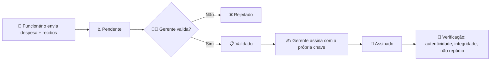
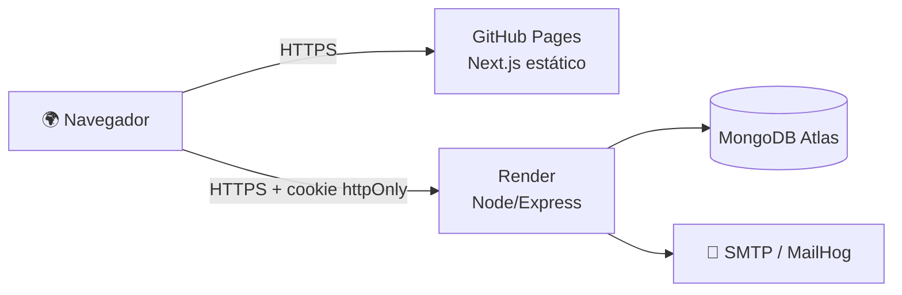

# 🔏 Assinatura Digital – Relatórios de Despesa


Módulo de **assinatura digital** para um negócio que precisa assinar documentos eletronicamente. O caso de uso escolhido é o **relatório de despesas**: o funcionário envia a despesa com recibos, o gerente valida, assina digitalmente e depois verifica a autenticidade da assinatura.

> 🎓 **Trabalho N2 – Segurança da Informação**
> Centro Universitário Católica de Santa Catarina · Prof. Claudinei Dias (Ney)

---

## 🌐 Demonstração online

| Serviço | Endereço |
|---|---|
| 🖥️ Frontend (GitHub Pages, HTTPS) | https://patrickgusmao10.github.io/assinatura-digital/ |
| ⚙️ API (Render, HTTPS) | https://assinatura-api-xod9.onrender.com/health |
| 🗄️ Banco de dados | MongoDB Atlas (nuvem) |

> ⏳ A API roda no plano gratuito do Render e "dorme" quando fica parada. O **primeiro acesso pode levar cerca de 50 segundos**.

---

## 👥 Participantes

| # | Integrantes |
|---|-------------|
| 1 | Patrick Gusmão |
| 2 | Lucas Moreira |
| 3 | Bruno Costa |
| 4 | Enzo Oliveira |

---

## ✨ Funcionalidades

- 🔐 **Login** com senha protegida por hash (bcrypt) e sessão JWT
- 👤 **CRUD de funcionários** (somente Gerente), com exclusão lógica quando há documentos vinculados
- 🧾 **Cadastro de despesas** com upload de recibos (PDF, PNG ou JPG)
- ✅ **Validação** do documento pelo Gerente (aprovar ou rejeitar, com observação)
- ✍️ **Assinatura digital** (RSA-PSS) com confirmação por senha
- 🔎 **Verificação** de autenticidade, integridade e não repúdio
- 📧 **Notificações por e-mail** com Nodemailer em cada etapa
- 📜 **Trilha de auditoria** das ações importantes

---

## 🔄 Fluxo do documento



| Status | Significado |
|---|---|
| ⏳ `pending` | Aguardando validação do Gerente |
| 📋 `validated` | Validado, aguardando assinatura |
| ❌ `rejected` | Rejeitado pelo Gerente |
| 🔏 `signed` | Assinado digitalmente |

---

## 🧱 Stack e arquitetura

| Camada | Tecnologia |
|---|---|
| 🎨 Frontend | Next.js 14 (Pages Router, export estático), React, Material-UI, Tailwind CSS |
| ⚙️ Backend | Node.js 20, Express, Mongoose, Zod, Multer, Nodemailer |
| 🗄️ Banco | MongoDB Atlas |
| 🐳 Infra local | Docker Compose (backend, mongo, frontend com nginx, MailHog) |
| 🚀 Publicação | GitHub Pages (frontend) + Render (API) |



---

## ✍️ Como a assinatura digital funciona

1. 🔑 **Chaves:** ao criar um usuário, é gerado um par de chaves **RSA-PSS 3072 bits** com a **Web Cryptography API** (`crypto.subtle`). A chave pública fica no banco.
2. 🔒 **Chave privada protegida:** ela só é guardada **cifrada** (AES-256-GCM), com chave derivada da senha do usuário (scrypt). Só é aberta em memória, no instante da assinatura.
3. 📦 **O que é assinado:** um JSON canônico com os dados da despesa, o **SHA-256 de cada recibo**, quem validou, quem assina e a data/hora.
4. ✅ **Verificação:** o sistema confere quatro pontos:

| Verificação | O que garante |
|---|---|
| ✔️ Assinatura válida | **Autenticidade**: a assinatura confere com a chave pública |
| ✔️ Dados íntegros | **Integridade**: os dados atuais são iguais aos assinados |
| ✔️ Recibos íntegros | **Integridade**: o SHA-256 de cada arquivo confere |
| ✔️ Chave do signatário | **Não repúdio**: a chave pertence ao signatário, que a destrava com a própria senha |

> 🧑‍⚖️ **Segregação de funções:** ninguém valida ou assina um documento enviado por si mesmo.

---

## 🛡️ Medidas de segurança

| Ameaça / Requisito | Proteção implementada |
|---|---|
| 🔑 Senhas | Hash **bcrypt** (custo 12); comparação em tempo constante |
| 🪪 Autenticação | **JWT** (HS256) em cookie `httpOnly`, `Secure`, `SameSite`; expira em 2 h |
| 🎭 CSRF | Token CSRF embutido no JWT e exigido no header `X-CSRF-Token` em requisições que alteram dados |
| 💉 Injeção (NoSQL) | `express-mongo-sanitize` + validação de entrada com **Zod** |
| 🧪 XSS | Escape automático do React, remoção de `<` e `>` nas entradas, **CSP** restritiva |
| 🪖 Cabeçalhos HTTP | **Helmet** (CSP, HSTS, nosniff, frame-ancestors none…) e cabeçalhos no nginx |
| 🚦 Força bruta | `express-rate-limit`: 10 tentativas de login a cada 15 minutos |
| 📎 Upload | Lista de tipos permitidos, limite de 5 MB e 5 arquivos, **conferência dos magic bytes**, nome aleatório |
| 🚫 Controle de acesso | Perfis Gerente/Funcionário verificados no backend |
| 🧾 Auditoria | Registro de login, validação, assinatura e verificação |
| 🐳 Contêineres | `no-new-privileges`, `cap_drop: ALL`, sistema de arquivos somente leitura (backend), usuário sem root, limites de memória e PIDs, banco em rede interna |
| 🔒 HTTPS / TLS | GitHub Pages e Render servem por HTTPS com certificado TLS válido |

---

## ✅ Requisitos do enunciado

| # | Requisito | Situação |
|---|---|---|
| 1 | Docker com políticas de segurança (backend, banco e servidor web) | ✅ |
| 2 | Banco MongoDB em nuvem (Atlas) | ✅ |
| 3 | Frontend Next.js com Material-UI e Tailwind CSS | ✅ |
| 4 | Backend Node/Express com JWT | ✅ |
| 5 | Chaves e assinatura com Node Crypto e Web Cryptography API | ✅ |
| 6 | Proteções (injeção, XSS, CSRF), Helmet e publicação com HTTPS | ✅ |
| 7 | Páginas mínimas e e-mail com Nodemailer | ✅ |

### 📄 Páginas

| Página | Função |
|---|---|
| `login.js` | Autenticação de usuários |
| `dashboard.js` | Painel principal com atalhos e documentos recentes |
| `employees.js` | CRUD de funcionários |
| `submitExpense.js` | Envio de despesa com recibos |
| `pendingExpenses.js` | Documentos pendentes de validação e de assinatura |
| `validateExpense.js` | Visualizar e validar/rejeitar um documento |
| `signExpense.js` | Assinar digitalmente |
| `signedExpenses.js` | Lista de documentos assinados |
| `verifySignature.js` | Verificar a autenticidade da assinatura |

---

## 🗂️ Estrutura do projeto

```
assinatura-digital/
├── docker-compose.yml
├── .env.example
├── .github/workflows/deploy-pages.yml
├── backend/
│   ├── Dockerfile
│   └── src/
│       ├── server.js     # Express, Helmet, CORS, sanitização
│       ├── routes.js     # rotas: auth, funcionários, despesas, assinatura
│       ├── auth.js       # JWT + CSRF
│       ├── crypto.js     # chaves, assinatura e verificação (Web Crypto API)
│       ├── models.js     # User, Expense, AuditLog
│       └── mailer.js     # Nodemailer
└── frontend/
    ├── Dockerfile        # build + nginx sem root
    ├── pages/            # as 9 páginas + _app e index
    ├── components/       # Layout, tabela, detalhes
    └── lib/              # api.js e auth.js
```

---

## 🚀 Como executar localmente

**Pré-requisito:** Docker Desktop instalado e aberto.

```bash
# 1. Clonar o repositório
git clone https://github.com/patrickgusmao10/assinatura-digital.git
cd assinatura-digital

# 2. Criar o arquivo de configuração
cp .env.example .env        # no Windows: copy .env.example .env

# 3. Subir tudo
docker compose up --build
```

| Serviço | Endereço |
|---|---|
| 🖥️ Frontend | http://localhost:3000 |
| ⚙️ API | http://localhost:4000/api |
| 📧 E-mails de teste (MailHog) | http://localhost:8025 |

🔑 O Gerente inicial é criado a partir de `SEED_MANAGER_EMAIL` e `SEED_MANAGER_PASSWORD` do `.env`.

### ⚙️ Variáveis de ambiente principais

| Variável | Descrição |
|---|---|
| `MONGODB_URI` | String de conexão (local ou MongoDB Atlas) |
| `JWT_SECRET` | Segredo do JWT (mínimo 32 caracteres) |
| `CORS_ORIGIN` | Origem permitida do frontend |
| `COOKIE_SECURE` / `COOKIE_SAMESITE` | `false`/`lax` local; `true`/`none` em produção |
| `SEED_MANAGER_*` | Dados do Gerente inicial |
| `SMTP_*` | Servidor de e-mail (vazio = apenas registra no log) |

> ⚠️ **Nunca** envie o arquivo `.env` ao GitHub. Ele já está no `.gitignore`.

---

## 🌍 Publicação

1. 🗄️ **Banco:** cluster gratuito no MongoDB Atlas, com acesso liberado para a API.
2. ⚙️ **API:** serviço *Web Service* no Render (runtime Docker, *Root Directory* `backend`), com as variáveis de ambiente configuradas.
3. 🖥️ **Frontend:** GitHub Actions (`deploy-pages.yml`) faz o build estático e publica no GitHub Pages. O endereço da API vem do *secret* `API_URL`.

---

## 🧪 Testes realizados

- ✅ Login de Gerente e Funcionário
- ✅ Cadastro, edição e exclusão de funcionários (exclusão lógica quando há documentos)
- ✅ Envio de despesa com recibos
- ✅ Validação, rejeição, assinatura e verificação
- ✅ **Adulteração:** alterar o valor direto no banco faz a verificação falhar
- ✅ Upload de arquivo não permitido recusado
- ✅ E-mails de cada etapa recebidos no MailHog
- ✅ Acesso restrito ao Gerente nas páginas administrativas

---

## ⚠️ Limitações

- 🏛️ É uma assinatura eletrônica **avançada** (Lei 14.063/2020), com chaves próprias. A assinatura **qualificada** (ICP-Brasil, MP 2.200-2/2001) exigiria certificado A1/A3 e carimbo do tempo (RFC 3161). A data da assinatura aqui é a do servidor.
- 💾 No plano gratuito do Render o disco é temporário: os **recibos enviados podem ser apagados** quando o serviço reinicia.
- 🔑 A senha do usuário protege a chave privada; por isso não é alterada pelo CRUD de funcionários.
- 📧 Na API publicada, sem SMTP configurado, os e-mails são apenas registrados no log.

---

## 📚 Referências

- Lei nº 14.063/2020 (assinaturas eletrônicas) e MP nº 2.200-2/2001 (ICP-Brasil)
- [Web Cryptography API](https://developer.mozilla.org/docs/Web/API/Web_Crypto_API)
- [OWASP Cheat Sheet Series](https://cheatsheetseries.owasp.org/)

---

<p align="center">Feito com 💙 para a disciplina de Segurança da Informação · 2026</p>